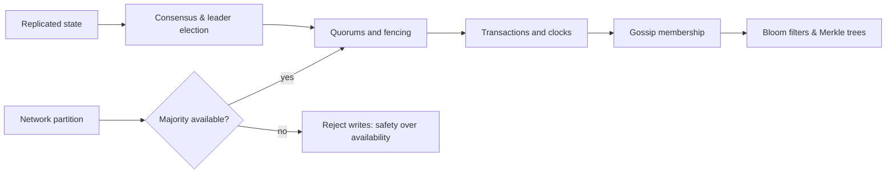

# Distributed Systems — Module 12

Module 12 · Distributed Systems: a single Java 21 learning repository with runnable examples, focused JUnit tests, trade-offs, and links to primary references. Demos are local and deterministic except for cryptographic randomness/timing; no cluster, cloud account, or external service is required.

## Learning map



## Topics

- [Distributed Consensus (Raft, Paxos)](consensus/README.md)
- [Leader Election](leader-election/README.md)
- [Distributed Locking](distributed-locking/README.md)
- [Distributed Transactions (2PC, 3PC, Saga)](distributed-transactions/README.md)
- [Clock Synchronization (Lamport, Vector Clocks)](logical-clocks/README.md)
- [Gossip Protocol](gossip/README.md)
- [Split-Brain Problem](split-brain/README.md)
- [Quorum-Based Systems](quorums/README.md)
- [Bloom Filters](bloom-filters/README.md)
- [Merkle Trees](merkle-trees/README.md)

## Topic guide, example, and primary reference index

| Topic guide | Runnable example | Primary reference |
| --- | --- | --- |
| [Distributed Consensus (Raft, Paxos)](consensus/README.md) | [ConsensusDemo.java](distributed/src/main/java/com/absolutebonkers/distributed/distributedconsensus/ConsensusDemo.java) | [Reference](https://raft.github.io/raft.pdf) |
| [Leader Election](leader-election/README.md) | [LeaderElectionDemo.java](distributed/src/main/java/com/absolutebonkers/distributed/leaderelection/LeaderElectionDemo.java) | [Reference](https://raft.github.io/raft.pdf) |
| [Distributed Locking](distributed-locking/README.md) | [DistributedLockingDemo.java](distributed/src/main/java/com/absolutebonkers/distributed/distributedlocking/DistributedLockingDemo.java) | [Reference](https://etcd.io/docs/v3.5/dev-guide/api_concurrency_reference_v3/) |
| [Distributed Transactions (2PC, 3PC, Saga)](distributed-transactions/README.md) | [DistributedTransactionsDemo.java](distributed/src/main/java/com/absolutebonkers/distributed/distributedtransactions/DistributedTransactionsDemo.java) | [Reference](https://microservices.io/patterns/data/saga.html) |
| [Clock Synchronization (Lamport, Vector Clocks)](logical-clocks/README.md) | [ClockSynchronizationDemo.java](distributed/src/main/java/com/absolutebonkers/distributed/clocksynchronization/ClockSynchronizationDemo.java) | [Reference](https://lamport.azurewebsites.net/pubs/time-clocks.pdf) |
| [Gossip Protocol](gossip/README.md) | [GossipProtocolDemo.java](distributed/src/main/java/com/absolutebonkers/distributed/gossipprotocol/GossipProtocolDemo.java) | [Reference](https://www.cs.cornell.edu/home/rvr/papers/flowgossip.pdf) |
| [Split-Brain Problem](split-brain/README.md) | [SplitBrainDemo.java](distributed/src/main/java/com/absolutebonkers/distributed/splitbrain/SplitBrainDemo.java) | [Reference](https://raft.github.io/raft.pdf) |
| [Quorum-Based Systems](quorums/README.md) | [QuorumBasedSystemsDemo.java](distributed/src/main/java/com/absolutebonkers/distributed/quorumbasedsystems/QuorumBasedSystemsDemo.java) | [Reference](https://cassandra.apache.org/doc/latest/cassandra/architecture/dynamo.html) |
| [Bloom Filters](bloom-filters/README.md) | [BloomFilterDemo.java](distributed/src/main/java/com/absolutebonkers/distributed/bloomfilters/BloomFilterDemo.java) | [Reference](https://doi.org/10.1145/362686.362692) |
| [Merkle Trees](merkle-trees/README.md) | [MerkleTreeDemo.java](distributed/src/main/java/com/absolutebonkers/distributed/merkletrees/MerkleTreeDemo.java) | [Reference](https://csrc.nist.gov/pubs/fips/180-4/upd1/final) |

## Build and run

Install JDK 21 and run at the repository root:

```sh
./gradlew test
./gradlew build
./gradlew :distributed:run --args=consensus
```

Every topic guide provides its exact run command and focused test selector. To run other examples, use the matching topic slug shown above.

## Design trade-offs at a glance

- **Consistency vs. availability:** a majority quorum avoids conflicting leaders and writes, but a minority partition cannot safely make progress.
- **Latency vs. fault tolerance:** replication and quorum acknowledgements improve resilience while adding network round trips and coordination.
- **Space vs. precision:** Bloom filters trade a compact representation for possible false positives; Merkle trees trade hashing work for efficient integrity proofs.

## Safety note

Security examples are defensive demonstrations only. They use harmless placeholder values, do not include attack payloads, do not access real credentials, and do not perform network exploitation. Cryptographic demos use JDK APIs for learning and are not a substitute for a reviewed production security design.
